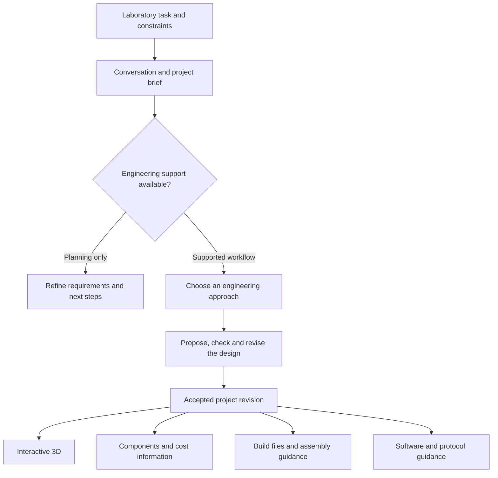

# A platform for custom laboratory automation

[Back to AutoLab](../README.md) · [Documentation](README.md)

AutoLab is being built to help researchers turn repetitive laboratory work
into automation setups designed around their own needs. The starting point is
the work: what needs to happen, what the lab already has, and what would make
the result useful. The machine follows from those requirements.

A setup may involve motion, sample handling, imaging, fixtures or several of
these together. That is the product direction. Each workflow needs its own
engineering checks. Liquid handling is the first deeply developed example.
The shared custom-equipment path also creates original proposed assemblies from
bounded geometry and motion descriptions. It provides an engineering concept
that can be reviewed and revised, with the limits described below.

## From requirements to a setup

1. **Understand the work.** Describe the process, materials, equipment, space and
   constraints in ordinary language. Collect task-specific measurements when
   they become relevant.
2. **Choose an approach.** Discuss suitable equipment, existing open projects,
   custom modules and the tradeoffs between building and buying. A supported
   engineering route starts with an explicit choice.
3. **Develop the design.** Refine the setup in conversation. For supported
   modules, the accepted design connects the 3D view, component choices,
   cost information and assembly guidance.
4. **Prepare to use it.** Export the supported project files and consult the
   software and programming guidance for the selected equipment. Keep assembly,
   commissioning and experimental validation as distinct steps.
5. **Adapt it as the work changes.** Reopen a project, revise a supported module
   or plan another procedure using the same equipment.

## One project, specialized engineering

The application separates the general requirements conversation from engineering
logic for a particular workflow. A shared brief records the objective, process,
materials, available equipment and constraints. A workflow capability check
determines what can happen next.

OpenAI models handle discovery, explanation and supported design proposals.
Application code validates the structured updates, applies workflow-specific
checks and derives the supported outputs. Source identity and project revisions
connect those outputs. A rejected design update preserves the accepted project.

This separation allows a new workflow to have its own requirements, geometry and
checks while retaining the common project experience. A model can propose a new
custom assembly through the shared concept compiler; it cannot add a new
geometry primitive, import arbitrary source CAD or implement a device driver
through a prompt. Those capabilities need implementation and their own checks.

### Compare design options

Describe the operations, materials, performance, interfaces and equipment you have.
The assistant can record alternatives under **Design options**. Each alternative
identifies the operations a supported adapter can represent, any manual steps,
the sources considered and what still requires a measurement. Catalog references,
supplier matches, pinned public CAD and your inventory statement have distinct
origins. A search result establishes identity and file availability. Mechanical
fit and instrument performance need their own checks.

Choose an option by its displayed name or position in chat. An applied revision
appears after the fixture, custom design, bench station, imported part, workstation
platform or BOM selection succeeds. When a measurement decides the fit, a fixture
parameter entered in millimetres is checked against the recorded answer. If an
existing station cannot fit a newly requested workspace, its previous geometry
remains available during the comparison. A successful replacement takes on the
new dimensions. Save/Open preserves the comparison, including a pending constraint.

## Current implementation

| Layer | Available now |
| --- | --- |
| Requirements and planning | A general brief can generate a revision-specific functional plan with ordered operations, equipment roles, handoffs, acceptance checks and open questions. The specification is downloadable as JSON. |
| Engineering | Liquid-preparation designs using Jubilee source CAD with custom modules or a schematic Opentrons OT-2 configuration; a separate bounded non-liquid bench-station adapter; custom assemblies composed from boxes, cylinders and spheres, with proposed attachments and bounded translation/rotation. |
| Components and cost | Supported US catalog retrieval, source references, selected alternatives and separately labelled planning estimates. Coverage depends on the supported component catalog. |
| Project continuity | Revisioned designs, portable save/reopen, supported design changes and revision-specific exports. |
| Software | Equipment-specific setup and protocol-authoring guidance, a standalone logical direct-dilution preview, an operator-assisted bench-station record runner, and a custom-assembly Python sequence controller with default simulation and an opt-in JSON/HTTP gateway integration. |

The software workspace also composes recorded measurements with operations on a
bench station or custom assembly. A single adapter supplies the input schema,
units and calibration instructions to both designs. [Measurement adapter contract](measurement-adapters.md).

### Inspect the parts in a project

Open **Parts & prices** and select **Assembly JSON** to download the physical
assembly for the displayed revision. The same record is included in supported
build ZIPs and in the bench-station plan. Its project ID survives Save/Open.
The API download takes the active session ID and the displayed revision.

Each instance has a stable ID, a native component key and a reference to its
geometry. Its placement gives both the translation in its parent frame and the
resulting project coordinates in millimetres. For example, a camera mounted on
a moving stage retains its offset from the stage at rest. The project uses Y
up. An imported CAD model also records its normalized Z-up frame, the source
units and the import transform when available. A separately printed fit coupon
has its own frame and an empty assembly placement.

The geometry fingerprint covers the compiled shapes, frames and placements.
The source manifest carries the checksum of the original imported file.

Connections identify their two interfaces and the evidence for the proposed
mount, mating feature or working axis. Purchasing requirements link back to BOM
line IDs, selected part identities and any associated instances. A catalog
electrical specification describes a requirement. A modeled mount, a commercial
envelope and a pinned source file each carry their own origin and evidence.

Portable files keep the existing design inputs and a compact geometry
fingerprint. Opening an earlier file reconstructs the assembly through its
original design compiler. For a saved fingerprint mismatch or a known
geometry-changing compiler migration, the application opens a new draft revision
for review and approval. The original file stays available to its owner.

The [liquid-handling example](use-cases/liquid-handling.md) shows the engineering
layer in detail: a workstation adapted to tubes or a microplate, component
choices, pricing and instructions. Its test records establish that specific
coverage. The [non-liquid bench station](bench-station.md) adds another specific
path: ordered weighing, printing, barcode reading and visual inspection modules,
conceptual access envelopes, sourcing references and a local human-checkpoint
runner. It generates no vendor CAD, automated transport or instrument control.

The [custom-equipment path](custom-equipment.md) handles other proposed setups
without selecting a fixed example machine. The model authors named components,
primitive solids, attachments, operating steps and equipment interfaces. The
compiler applies dimension, reference, attachment and conservative interference
checks. The viewer, per-part models, parts list, guide and controller data derive
from the accepted design revision. Source links identify reviewed candidates;
the generated solids remain custom geometry.

Current designs are digital proposals. Jubilee and OT-2 have no AutoLab
hardware-control or physics adapter. Custom assemblies have a real JSON/HTTP
gateway client, but require a separately implemented, commissioned device
gateway and explicit action mappings before hardware use. A logical simulation,
an animated preview, a gateway acknowledgement and a physical experiment provide
different evidence. Physical fit, mounting, calibration and laboratory performance
require separate work. See the [verification record](verification.md) for the
checks actually performed.

## Extending the platform

A new engineering workflow should define its required inputs, supported hardware
and source references, design representation, checks and available outputs.
Its viewer, component information, instructions and exports should describe the
same accepted revision. Unsupported operations should remain visible in planning
instead of being represented as completed engineering.

Useful starting points in the code:

- [Workflow registry and generic brief](../app/workflows.py).
- [Model instructions and structured proposals](../app/model_client.py).
- [Source and adapter policy](source-grounding.md).
- [Development and verification commands](development.md).

This is the extension approach for the codebase. The shared concept path can
generate new proposed arrangements within its geometry and motion vocabulary;
there is no automatic plugin installer, unrestricted CAD generator or automatic
hardware commissioning.

## Place external CAD in an existing design

In chat, identify the repository, full commit, file and instance name. Give the
mounting datum, translation in millimetres and any rotation relative to the
project frame or a placed part. A second instance can use the first as its
parent. STEP carries source units. For STL, supply the units used by the
designer. An optional access check takes a face in the instance's local Y-up
axes and a required clearance in millimetres.

For example, after selecting a source, ask to place the lamp holder 80 mm to
the right of the base origin, with its lower face 16.4 mm above that origin.
To reserve access from above, specify the distance along local +Y. The assistant
can then generate a mating plate for that named solid STEP instance. Repeating
the same import or adaptation at the current revision preserves its identity and
revision. A conflicting name, failed inspection or stale revision leaves the
previous assembly available.

**Attached CAD** shows the original repository, commit, file checksum, units,
license and placement. Interference between a STEP source and its generated
adapter uses solid intersection. The whole assembly and specified access spaces
use conservative bounding boxes at the rest pose. A printer build volume is
needed for the adapter fit check. Physical fit and access require bench testing.

### Revise and hand off an assembly

Ask, for example, “Change only the lamp holder's adapter plate thickness to 8 mm.”
The assistant carries forward the existing hole pattern, clearance and placement.
The revision records the changed dimensions, which adapter to reprint and which
mounting datums to recalibrate after installation.

For a design with attached CAD, **Save project** downloads a ZIP. **Open project**
on a second installation reads it offline. The package contains the original pinned
assets and their notices, normalized geometry, previews and generated mating parts.
The manifest identifies the project, revision and assembly fingerprint and lists
each file's size and SHA-256. The receiving workspace checks these records before
installing the CAD assets. Its local cache keeps the issued archive for repeat
downloads of that revision. **Attached CAD → Project inputs (JSON)** saves a
lightweight snapshot even when the local CAD worker cannot build the full ZIP.
It references external geometry by digest. The standalone snapshot API serves
the same file.

The assembly STEP and STL use the 3D scene's rest pose, in millimetres with +Y up.
STEP sources retain boundary geometry. STL sources contribute triangle faces
(up to 75,000 per source). The CAD index names placed parts and marks commercial
proxies and planning envelopes. It also lists unplaced fabrication parts.
For assemblies with more than 128 solids, the review STL is written in groups
with 0.1 mm linear and 0.3 radian angular deflection. The index records the
mesh settings for each exported assembly. The Jubilee foundation uses a shared
STEP definition for each repeated component. The verified 809-solid foundation
and its attached module produced a 91 MB ZIP.
The purchasing files preserve the issued documented prices, budget allowances and
printed-material estimates. The guide and device assignments identify the mounts
and interfaces that require installation checks. The custom-equipment package
includes the offline controller and its configuration. A workstation package
includes the preparation table and logical preview. A reported rest-pose overlap
identifies a pair to measure before fabrication. Imported geometry carries no
device driver. The package limits are 128 MiB compressed and 384 MiB expanded,
including the manifest. Redistribution requires an accepted
source license. Physical calibration and build verification take place on the bench.
